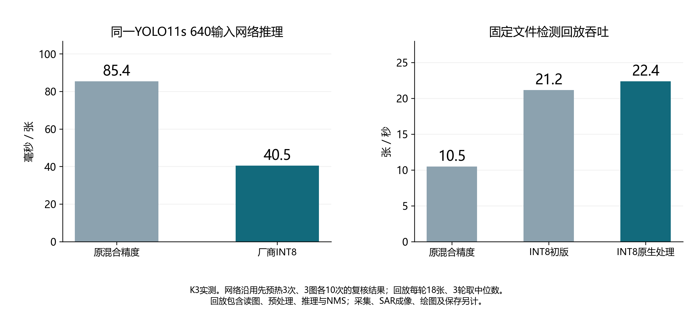

# RISC-V 雷达联合项目

> **求职/项目展示入口：**[雷达智脑 · RISC-V SAR 成像与智能感知（系统架构、实测、报告、视频）](portfolio/README.md)

围绕雷达采集、SAR 成像、RISC-V / K3 目标检测与 FPGA 图像接口开展开发。

仓库：<https://github.com/ccj-bot/radarbrain-riscv-sar>

| 路径 | 内容 |
| --- | --- |
| `src/k3/` | K3 部署、INT8 推理、原生前后处理、RDA/BP 与运行库安装脚本 |
| `src/acquisition/` | NX 雷达/相机采集、控制服务、驱动与既有测试 |
| `src/imaging/bp/` | 可独立运行的合成回波 BP 示例 |
| `src/detection/` | PT、ONNX 推理参考实现 |
| `hardware/fpga/` | v1.1 RTL、构建约束、初始化表、插值仿真与帧接口 |
| `docs/` | 本次迁移说明、运行入口和 GitHub 使用方法 |

源码起点为 2026-11-08 正式源码包，2026-11-12 迁入本仓库。此后以本仓库推进新内容。

**仓库不包含模型权重。** 模型及回放输入只在本地保留，受 `.gitignore` 排除；从 GitHub 克隆后，需自行取得经授权的模型和数据。禁止通过 Git LFS、压缩包或改扩展名上传权重。

本展示分支在 portfolio/ 提供演示视频、正式报告及结果图；原工程代码与设备运行环境保持在既有目录，二进制运行库、模型和原始数据不纳入。原技术 README 与第三方许可按需保留；其中历史路径和测量结果属于迁移来源，当前操作说明见 [运行入口](docs/RUNNING.md)。

- [迁移范围](docs/MIGRATION.md)
- [运行入口与依赖](docs/RUNNING.md)
- [GitHub 关联与日常同步](docs/GITHUB.md)

本次完成文件迁移与静态检查，没有重新执行 K3、NX 或 FPGA 实机测试。
