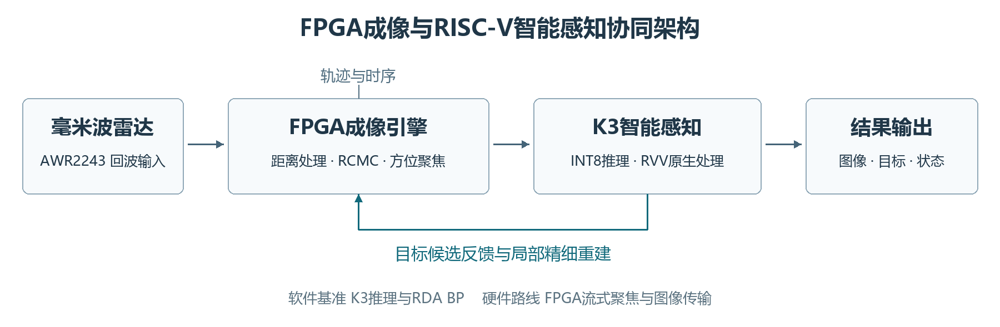
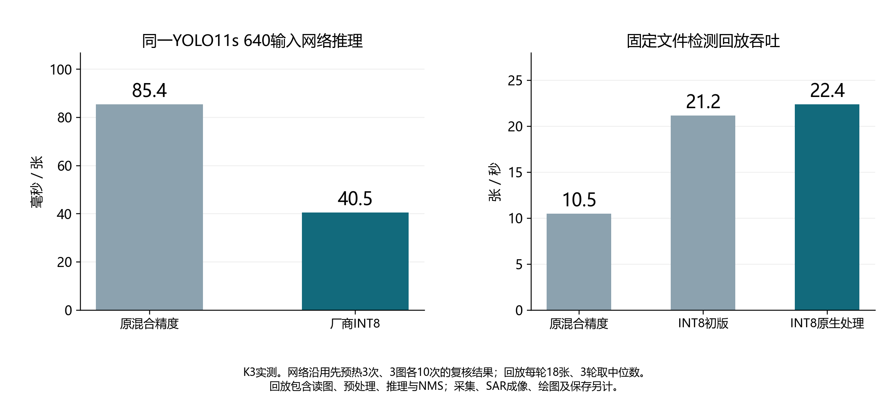
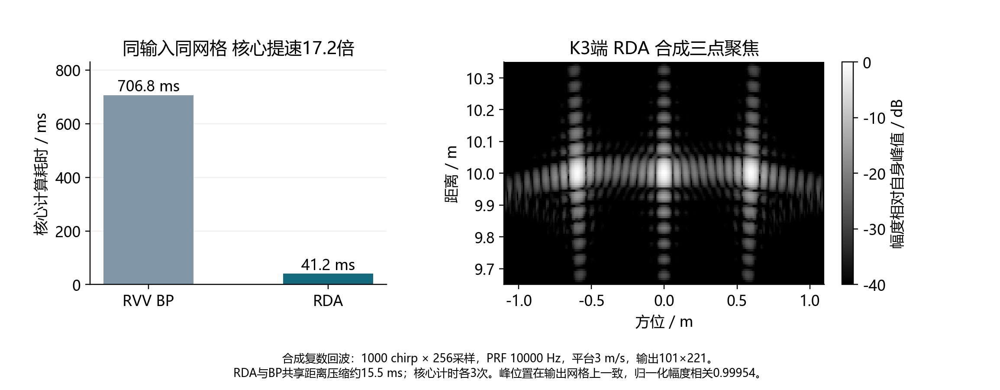

# 雷达智脑｜RISC-V 异构计算的 SAR 成像与智能目标感知

**RadarBrain · 面向车载/移动机器人的雷达成像与端侧 AI 项目展示**

2026 年深圳大学「雷帝队」参赛与研发项目。项目负责人：陈嘉瑜；成员与指导教师见[项目设计报告](PROJECT_REPORT.pdf)。

## 项目简介

项目以 AWR2243 毫米波雷达回波采集为起点，结合 SAR 成像、FPGA 流式处理接口与 K3 RISC-V 边缘平台目标检测，探索“快速全局成像 + 目标反馈局部精细计算”的系统协同架构。

在当前仓库中，已经保留 **K3 板端部署与优化源码、NX 采集代码、BP 合成回波成像参考程序、目标检测推理代码与 FPGA RTL 工程**。本展示分支补充正式报告、成果图、实测说明和竞赛演示视频，方便查看和核对。

## 主要技术工作

- **RISC-V 端侧模型部署**：在 K3 平台上部署 YOLO11s，使用 XSlim 进行 INT8 校准，保留检测头坐标解码与分类后处理为浮点，并利用原生 C++ 预处理、NMS 与流水线调度优化运行。
- **雷达成像与计算对照**：完成 RDA 与 BP 的软件数值对照、原始 bin RD 回放及计算核心耗时分析，研究快速全局成像与局部精细重建的取舍。
- **软硬件协同架构**：整理 FPGA 流式成像计算、帧元数据接口、K3 端侧推理及反馈调度设计，并开展部分 RTL 子模块仿真与接口验证。

## 代表性结果（2026-11-08）

| 指标 | 结果 | 说明 |
|---|---:|---|
| YOLO11s 640 输入纯网络推理 | **85.4 → 40.5 ms** | K3 厂商运行时，INT8 主干 + 浮点解码，不包含采集与成像 |
| 固定 SAR 文件检测回放 | **约 22.4 张/秒** | 读取、预处理、网络、NMS 流水线；非端到端雷达成像帧率 |
| 软件 RDA 核心 | **41.2 ms** | 三点合成回波、同输出网格 |
| 软件 RVV BP 核心 | **706.8 ms** | 同实验条件；RDA 核心约 **17.2×** |
| RDA/BP 归一化图像相关性 | **0.99954** | 受控三点场景数值比对 |

**测量范围：**上面数字分别属于板端纯网络、固定文件回放和受控软件成像核心，不代表 FPGA+采集+成像+目标检测完整硬件闭环的实时帧率。

## 相关代码与文件

| 内容 | 当前仓库对应路径 |
|---|---|
| K3 INT8 推理与流水线 | [src/k3/optimization_v4](../src/k3/optimization_v4) |
| K3 迭代优化版本 | [src/k3/optimization_v5](../src/k3/optimization_v5) |
| NX 多设备采集 | [src/acquisition](../src/acquisition) |
| BP 合成场景成像代码 | [src/imaging/bp](../src/imaging/bp) |
| 目标检测代码 | [src/detection](../src/detection) |
| FPGA RTL 与接口 | [hardware/fpga](../hardware/fpga) |
| 工程迁移及运行文档 | [docs/RUNNING.md](../docs/RUNNING.md) |

## 成果材料

- [正式参赛项目设计报告（PDF）](PROJECT_REPORT.pdf)
- [项目成果与测试报告（PDF）](TEST_REPORT.pdf)
- [测试指标与适用范围](BENCHMARKS.md)
- [项目演示视频（MP4）](demo/radarbrain_demo.mp4)
- [1024 位 RVV 调度日志展示](assets/04_rvv_trace.png)

## 复现与使用说明

项目包含部分可复现实验和真实板端调用代码，环境依赖请参见 [运行指南](../docs/RUNNING.md) 与 K3 子目录 README。

公开分支未提交原始雷达 ADC/bin、真实 SAR 全量数据、模型权重、设备私有配置或厂商闭源运行库。已有 FPGA 工程的第三方源码与许可归属以工程内文件为准。项目展示分支不作为完整硬件固件发行包，硬件联调需结合开发板、驱动、授权模型和实际雷达设备。

## 项目与个人贡献

团队：深圳大学雷帝队。项目负责人主要承担总体方案设计、跨模块工程组织、端侧优化实验与项目材料交付；具体硬件、软件和算法由团队协作推进。

**仓库说明：**此仓库为独立的 RISC-V 雷达联合工程仓库，本分支专门补充雷达智脑项目成果展示。默认主分支保留工程代码及原有开发记录。